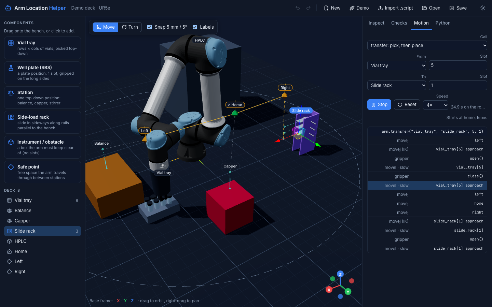

# Arm Location Helper

A teach pendant gives you numbers like `p[0.412, -0.188, 0.093, 2.221, -2.221, 0.0]`. Nobody can
read where that is, which way the gripper points, or how the arm will get there. Arm Location
Helper shows them in 3D. You lay out the deck around the arm (trays, stations, side-load racks,
instruments, safe points) and watch every move play out on a model of the arm. The tool then
exports one Python file: a pick-and-place controller that only moves along the paths you laid out.



It is part of the [IvoryOS](https://ivoryos.ai) ecosystem but needs none of it. It runs as a web page
(no install), as `python -m arm_loc_helper`, or as a tab in ivoryos-next. The exported controller
is a plain Python class: IvoryOS picks it up as an instrument with dropdowns for the locations, and
anything else can import it.

Universal Robots arms come first (UR3, UR5, UR10 and their e-series), driven through
[ur_rtde](https://sdurobotics.gitlab.io/ur_rtde/). The design leaves room for other arms (see
*Another robot* below).

## What it does

1. **Pick the arm and its TCP** (the gripper's fingertips, as on the pendant). Poses are TCP poses
   in the robot's base frame, the frame URScript and the pendant use.
2. **Import a `.script`** saved by Polyscope. Its waypoints (`Waypoint_1_p` and `Waypoint_1_q` become
   one waypoint), its `set_tcp(...)` and the order of its moves show up on the deck. Click a
   waypoint to build a tray, station, rack or safe point on it.
3. **Drag components onto the bench**, or build them on taught waypoints. Each component has a
   **skill**, the way the arm goes in and out of it:
   - **Top-down** (trays, plates, balances, cappers): the tool points straight down, and the arm goes
     in and out vertically. That covers almost all lab pick-and-place.
   - **Side-load** (a slide or plate rack with rails parallel to the bench, a hotel, a drawer): the
     tool is horizontal, and the arm goes in and out along the rack's axis.
4. **Place safe points and link them.** The arm travels between stations only through safe points:
   safe point → the station's safe point → approach point → slot, and back out the same way. With
   three safe points, any location can reach any other along a path you laid out.
5. **Read the checks.** They catch slots out of reach, poses that only work with the elbow down,
   and a taught pose that is 2.9° off vertical (with **Snap to vertical**). They also catch racks
   that are not square to the robot, safe points below their stations, safe points cut off from
   home, and a script whose TCP differs from the deck's.
6. **Preview a call** (`transfer`, `pick`, `place`, …) on the Motion tab. The arm moves the way a UR
   does: joint moves between safe points, straight lines into slots, with the item in the gripper.
   A stretch that leaves the arm's reach or flips the wrist is flagged before anything plays.
7. **Export the controller** on the Python tab.

## The exported controller

One file, standard library only (plus `ur_rtde` for a real arm):

```python
from demo_deck_arm import DemoDeckArm

arm = DemoDeckArm()                                # simulation: prints every move
arm = DemoDeckArm(host="192.168.1.10", speed=0.3)  # the arm, through ur_rtde, at 30% speed

arm.transfer("vial_tray", "balance", source_index=5)
arm.pick_from_slide_rack(2)                        # one pick/place method per location
arm.place_on_capper()
arm.home()
```

| Method | What it does |
| --- | --- |
| `pick(location, index)` / `place(...)` / `transfer(source, destination, ...)` | Through the safe network to the slot's approach point, straight in, grip or release, straight out |
| `pick_from_<location>(index)`, `place_on_` / `place_in_<location>(index)` | The same, named after the deck's own locations |
| `move_above(...)`, `move_to(...)` | To the approach point, or into the slot without the gripper |
| `home()`, `go_to_safe_point(name)` | Along the safe network |
| `plan(action, ...)` | The moves a call would make, without moving |
| `check()` | Asks the robot whether every pose is reachable and within its safety limits |
| `recover(safe_point=None)` | The one move off the safe network: straight to a safe point after a stop or a jog |
| `where()`, `set_speed(f)`, `open_gripper()`, `close_gripper()`, `disconnect()` | |

It refuses unsafe calls rather than guessing:
- **Unknown position.** At start-up it locates the arm against the safe points and approach points.
  If the arm is somewhere else (jogged by hand, or a move failed), nothing moves until you call
  `recover()`.
- **Gripper state.** It will not pick while holding something, place with an empty gripper, or
  carry on after a Robotiq gripper closes on nothing.
- **Safe points.** They are joint targets (taught joints are kept exactly), so the posture between
  stations is always the same.

Grippers: Robotiq 2F/Hand-E through the URCap socket (port 63352), a digital output (pneumatic,
tool I/O), or your own object with `open()` and `close()`.

**In IvoryOS** it is an ordinary instrument. Create it in your deck script, and every method shows
up in the workflow designer, with the locations and safe points as dropdowns (the exported class
types them as `Literal[...]`):

```python
import ivoryos_edge
from demo_deck_arm import DemoDeckArm

arm = DemoDeckArm()        # host="..." for the robot

if __name__ == "__main__":
    ivoryos_edge.run(__name__)
```

The same runtime is importable from the package, for decks kept as JSON (the Python tab's
`deck.json`):

```python
import json
from arm_loc_helper.runtime import ArmController
arm = ArmController(json.load(open("demo_deck_arm.deck.json")), host=None)
```

## Run it

**On the web**: the Vercel deployment. Nothing to install; decks stay in your browser and
in the `.deck.json` files you save.

**From Python**, no Node needed (the built page is in the package):

```bash
pip install "arm-loc-helper @ git+https://github.com/ivoryzh/arm-loc-helper.git"
python -m arm_loc_helper            # opens http://127.0.0.1:8765
```

**In ivoryos-next**, as a tab: `pip install "arm-loc-helper[edge]"`, then
`ivoryos_edge.run(__name__, plugins=[arm_loc_helper.next_plugin.plugin])`.

## Develop

```bash
npm install
npm run dev          # the editor, hot reload
npm test             # kinematics against every URDF, the deck model, checks, parser, and the
                     # exported Python run for real, planning exactly what the preview shows
npm run build        # into arm_loc_helper/static (commit it); dist/ on Vercel

uv venv && uv pip install -e ".[test]"
.venv/bin/python -m pytest     # the runtime: routing, refusals, ur_rtde and Robotiq against fakes
```

| Where | What |
| --- | --- |
| `arm_loc_helper/runtime.py` | The controller runtime: `ArmController`, drivers, grippers. Copied verbatim into every export |
| `src/lib/deck.ts` | The deck model: components, skills, slot and approach geometry, safe points |
| `src/lib/planner.ts` | The same planning as the runtime, for the preview (a test compares the two) |
| `src/lib/kinematics.ts`, `robots.ts` | Closed-form UR kinematics (from Beaver's Bench), the arm catalogue |
| `src/lib/checks.ts` | The recommendations and their fixes |
| `src/lib/motion.ts` | Plans turned into joint trajectories, with reach and wrist-flip detection |
| `src/lib/generator.ts`, `runtimeDeck.ts` | The exported Python file and the deck data in it |
| `src/lib/parser.ts`, `teach.ts` | `.script` waypoints, and turning them into components and safe points |
| `src/components/` | The 3D scene (react-three-fiber) and the panels |

The URDFs are ros-industrial's; the meshes load from jsDelivr, so the repository holds only the text
files. `scripts/make_e_series_urdf.py` writes the UR5e and UR10e URDFs from the UR3e one, using the
numbers in ur_description's config.

### Another robot

An arm is an entry in `src/lib/robots.ts` (kinematics, URDF, reach) and a driver class in
`runtime.py` with `move_joints`, `move_joints_to_pose`, `move_linear`, `actual_q`,
`actual_pose`, `reachable` and `close`. Pass it as `ArmController(deck, driver=MyDriver(...))`.
The editor's IK is UR-specific (closed form); another geometry needs its own solver.
